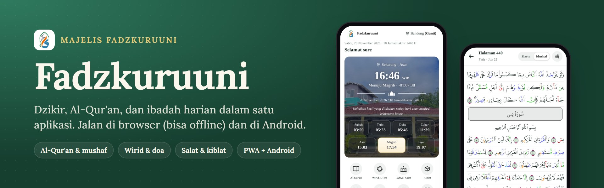
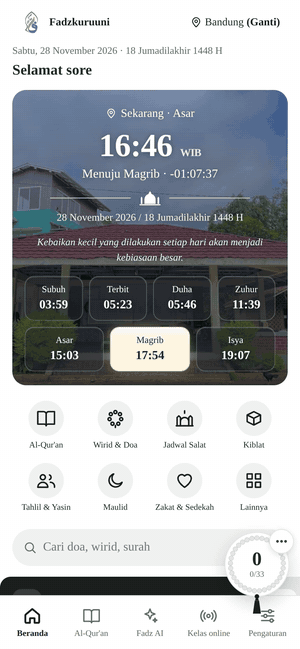
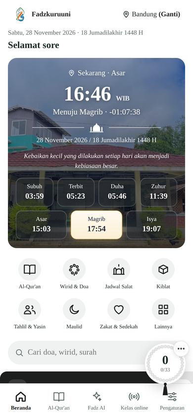
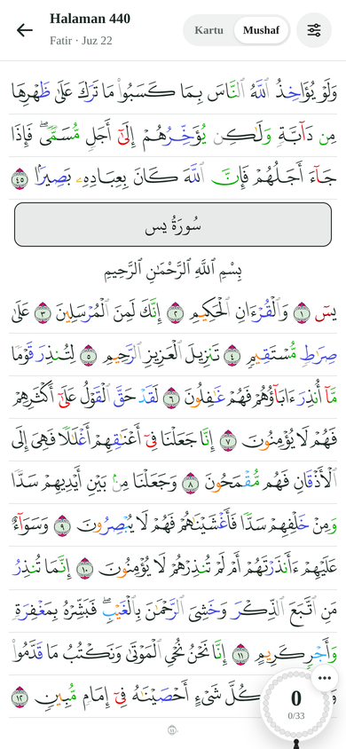
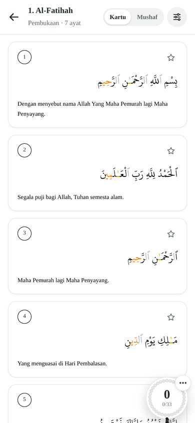
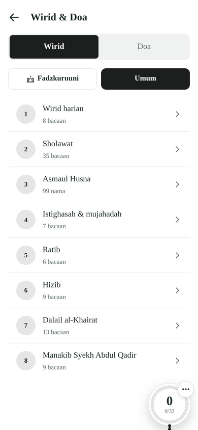
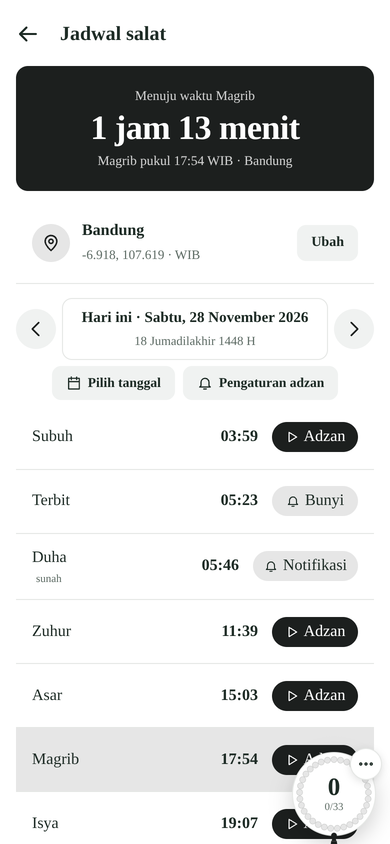
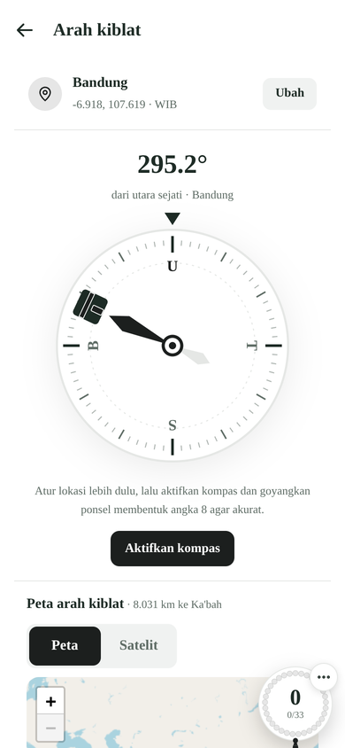
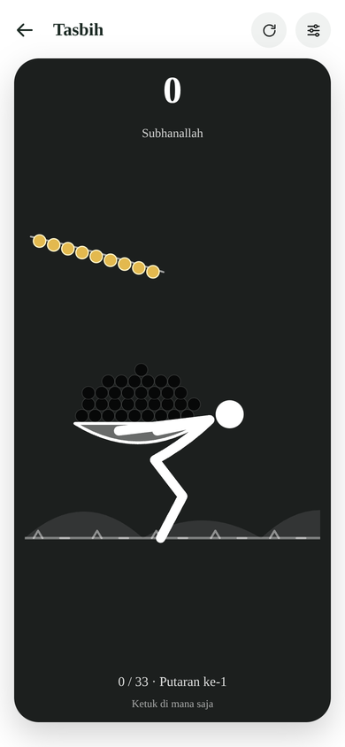

<p align="center">
  
</p>

<p align="center">
  <a href="https://majelisfadzkuruuni.web.id"></a>
  <a href="https://github.com/ky-Mind/majelisfadzkuruuni/releases/latest"></a>
</p>

<p align="center">
  
  
  
  
  
  
  
  
</p>

**Fadzkuruuni** adalah aplikasi dzikir, Al-Qur'an, dan ibadah harian dari Majelis Fadzkuruuni. Isinya Al-Qur'an dengan mode kartu dan mushaf, wirid & doa, tahlil, maulid, jadwal salat dan arah kiblat, kitab kuning, hadits, sampai kalkulator zakat dan waris. Jalan di browser sebagai PWA (bisa offline) dan tersedia sebagai aplikasi Android.

## Sekilas

<table>
  <tr>
    <td align="center"><br><sub>Beranda</sub></td>
    <td align="center"><br><sub>Jadwal salat hari ini</sub></td>
    <td align="center"><br><sub>Al-Qur'an mode mushaf</sub></td>
  </tr>
  <tr>
    <td align="center"><br><sub>Mode kartu + terjemah</sub></td>
    <td align="center"><br><sub>Wirid & doa</sub></td>
    <td align="center"><br><sub>Jadwal salat & adzan</sub></td>
  </tr>
  <tr>
    <td align="center"><br><sub>Arah kiblat</sub></td>
    <td align="center"><br><sub>Tasbih</sub></td>
    <td></td>
  </tr>
</table>

## Fitur utama

**Ibadah**
- **Al-Qur'an**: daftar surah, juz, riwayat baca, pencarian, mode **Kartu** (ayat per kartu dengan terjemah) dan **Mushaf** (per halaman, tajwid berwarna)
- **Wirid & doa**: wirid harian, sholawat, istighasah, ratib, hizib, Dalail al-Khairat, manakib, serta doa untuk berbagai keperluan
- **Asmaul Husna** dengan makna, dalil, penerapan, dan kisahnya
- **Tahlil & Yasin** dan **Maulid** (Diba'i, Barzanji, Simtud Durar, Burdah, Adl-Dliya'ul Lami', dan lainnya) dengan versi cetak PDF
- **Jadwal salat** per kota, pengingat adzan dan notifikasi, **arah kiblat** dengan kompas dan peta
- **Tasbih** digital dan tasbih melayang yang bisa digeser ke mana saja

**Belajar**
- **Kitab kuning** (Al-Hawi, Aqidatul Awam, Safinatun Najah, Fathul Qarib, Riyadhus Shalihin, dan lainnya) dan **Teka-Teki Kitab** untuk menguji hafalan
- **Hadits Nabi** per kitab, dengan judul, nama bab Indonesia, dan info sanad
- **Fadz AI**: tanya jawab seputar isi aplikasi, mode online (Groq) dan mode offline (AI kecil yang diunduh ke HP, butuh WebGPU), plus pesan suara
- **Kelas online**: pengajian live suara saja lewat LiveKit, dengan notifikasi kelas

**Keuangan & lainnya**
- Zakat mal, zakat fitrah & fidyah, infak, kurban, dan kalkulator zakat
- **Kalkulator waris (faraidh)** lengkap dengan hijab, awl, radd, dan kasus khusus
- Kalender Masehi, Hijriah, dan pasaran Jawa dengan hari besar dan puasa
- Unduhan offline per konten atau sekaligus, login Google/Email, penanda, tema terang/gelap
- Laporan bug/salah tulis dari pengguna, dengan dashboard admin

## Cara pakai

**Langsung di browser:** buka <https://majelisfadzkuruuni.web.id> (juga <https://fadzkuruuni.vercel.app>), lalu pilih *Tambahkan ke layar utama* agar terpasang seperti aplikasi. Isi Al-Qur'an, kitab, dan maulid bisa diunduh agar tetap terbaca tanpa internet.

**Android:** unduh `fadzkuruuni.apk` terbaru di halaman [Releases](https://github.com/ky-Mind/majelisfadzkuruuni/releases/latest), lalu pasang (izinkan *instal dari sumber tidak dikenal* bila diminta). Versi Android punya adzan yang tetap berbunyi walau aplikasi ditutup, murottal di latar belakang dengan notifikasi media, widget jadwal salat, dan lokasi otomatis. Pembaruan berikutnya diunduh langsung dari dalam aplikasi.

**Menjalankan sendiri:**

```bash
git clone https://github.com/ky-Mind/majelisfadzkuruuni.git
cd majelisfadzkuruuni
python3 -m http.server 8080      # lalu buka http://localhost:8080
```

Saat dijalankan lokal, fungsi di `api/` (AI, suara, kelas online) tidak ikut berjalan; halaman Fadz AI otomatis memakai mode pencarian isi aplikasi.

## Teknologi

HTML, CSS, dan JavaScript biasa tanpa bundler. Service worker untuk offline, Firebase (Auth + Firestore) untuk akun, laporan, dan kelas, serta serverless function di Vercel (runtime edge) untuk AI, suara, dan notifikasi.

| Fungsi | Berkas | Keterangan |
| --- | --- | --- |
| Fadz AI | `api/ai.js` | Meneruskan percakapan ke Groq; kunci `GROQ_API_KEY` hanya di Vercel |
| Pesan suara | `api/stt.js` | Rekaman suara jadi teks lewat Whisper di Groq |
| Suara jawaban | `api/tts.js` | Suara cadangan untuk tombol *Dengarkan* |
| Kelas online | `api/kelas.js` | Token LiveKit dan izin bicara (admin bicara, jamaah mendengar) |
| Notifikasi kelas | `api/push.js` | Web Push (VAPID) agar pemberitahuan tetap muncul saat aplikasi ditutup |
| Statistik unduhan | `api/unduhan.js` | Jumlah unduhan APK per versi dari GitHub Releases |

## Struktur

```
index.html      kerangka dan urutan pemuatan skrip
data/           data konten (Qur'an, doa, kota, hadits, maulid)
js/core/        fondasi bersama (state, UI, waktu, adzan, unduhan, cloud)
js/pages/       satu berkas per halaman
api/            serverless function (AI, STT, TTS, kelas, push)
kitab/          kitab kuning, satu folder per kitab
sw.js           service worker (cache offline)
admin.html      dashboard admin
```

Urutan pemuatan penting: data, lalu `js/core`, lalu `js/pages`, lalu `events.js` dan `router.js`. Saat berkas aset berubah, naikkan nilai `V` di `sw.js` agar cache diperbarui.

Dokumentasi lanjutan:
- [STRUKTUR.md](STRUKTUR.md): rincian folder, cara menambah halaman, kelompok Pengaturan, dan kitab
- [PANDUAN-FIREBASE.md](PANDUAN-FIREBASE.md): domain login, metode masuk, Rules Firestore, dan dashboard admin
- [PANDUAN-AI.md](PANDUAN-AI.md): memasang Fadz AI online (Groq) dan cara kerja mode offline

## Dashboard admin

`admin.html` (masuk dengan akun admin) punya tab **Laporan** (laporan pengguna beserta status), **Tampilan** (atur Beranda, pintasan, menu, dan pengumuman dengan pratinjau HP), **Peta aplikasi**, dan **Statistik** (tanpa data pribadi). Akses dikunci oleh aturan di `firestore.rules`.

## Lisensi

Lisensi kode belum ditetapkan, dan teks keagamaan di dalamnya berasal dari berbagai sumber dengan hak masing-masing. Rinciannya ada di folder [lisensi/](lisensi/).

---

<p align="center"><sub>Dibuat oleh <a href="https://github.com/ky-Mind">ky-Mind</a> · <a href="https://kymind.web.id">kymind.web.id</a></sub></p>
